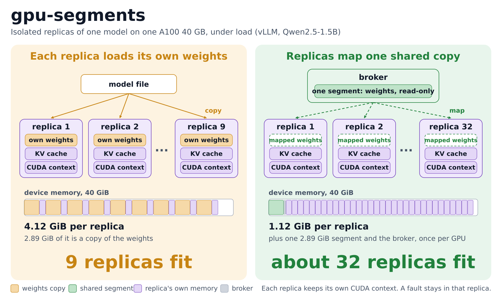

# gpu-segments

Several isolated processes that serve the same model on one GPU each load their own copy of the weights. gpu-segments loads the weights once. A broker process holds them in device memory, and each process maps that copy read-only.



The diagram shows measurements on one A100 40 GB with vLLM and Qwen2.5-1.5B, with replicas under load. Seven replicas that serve one trace use 28.9 GiB with private weights and 10.6 GiB with a shared segment, at the same throughput. The data and the experiments are in [elastic-gpu-research](https://github.com/ziyangliu-666/elastic-gpu-research), Results 33 to 40.

Isolation stays as it is:

- Each process keeps its own CUDA context and uses NVIDIA's unmodified driver library.
- A fault stays in the process that caused it. A store into a segment faults the writer.
- The broker can run in another container or as another user.

## Running

Needs Linux, an NVIDIA driver, the CUDA headers (`CUDA=/usr/local/cuda` by default), gcc, and PyTorch.

```console
$ make
$ python3 -m gpu_segments --socket /run/segments.sock --file llama=/models/llama.safetensors
```

Only registered names can be opened. Clients cannot name a path.

```python
from gpu_segments import Client

c = Client("/run/segments.sock")
weights = c.open("llama")             # {tensor name: read-only CUDA tensor}
model.load_state_dict(weights, assign=True)
```

## Park and resume

`c.park("llama")` unmaps the segment and frees the process's scratch memory. The tensors keep their addresses. `c.resume("llama")` maps the segment again at the same addresses, so the model needs no rebuild and no warm-up.

If the broker evicted the segment, `resume` waits while the broker loads it again, and returns True. If the file changed, the tensors then hold the new weights. If its layout changed, `resume` fails.

| step, 1.6 GB model, A100 | time |
|---|---:|
| park | 0.4 ms |
| resume, segment loaded | 1.3 ms |
| resume after eviction | about 120 ms |

To free the context's device memory too (about 500 MiB for a PyTorch process on an A100), checkpoint the parked process with `cuda-checkpoint --toggle`. Restore took 121 ms on an RTX 3060 with `CUDA_DEVICE_MAX_CONNECTIONS=1`, and 229 ms without it.

## Memory budget

`--budget-gib 30` caps the device memory of all segments. To load a new one past the cap, the broker evicts the least recently used segments that no client maps. If every loaded segment is mapped, the open fails.

## Accounting

`Client.usage()` returns the device memory that the broker charges to each uid.

- A segment that several uids map is split equally between them.
- A segment that is loaded but not mapped is charged to nobody, because the broker may evict it.
- The broker's uid and root see every uid. Other clients see only their own.

A scheduler can add this charge to the memory that a tenant's own contexts use.

## Broker restart

Mappings survive a broker crash: clients keep running on the memory they map. A client reconnects on its next call. After a restart, `resume` loads a fresh copy and returns True; the old copy is freed when the last client parks.

## Access

- The socket is mode 0660 by default. `--allow-uid` adds uids that may open segments.
- Only the broker's uid and root may evict.
- An fd received from the broker grants read access to the segment. Do not pass it on.
- A segment works across containers. A gVisor sandbox needs a change in nvproxy: [google/gvisor#16898](https://github.com/google/gvisor/pull/16898).

## Limits

- Weights must not change. Training needs ordinary memory.
- The broker refuses to evict a segment while any client maps it, because a later load would hold a second copy. `evict(force=True)` overrides this. A client that exits releases its mappings.
- The first load copies the file into pinned host memory, which stays allocated for later reloads.

## Tests

```console
$ python3 tests/segment_tests.py        # no GPU needed
$ make && python3 tests/segment_gpu_tests.py
```
